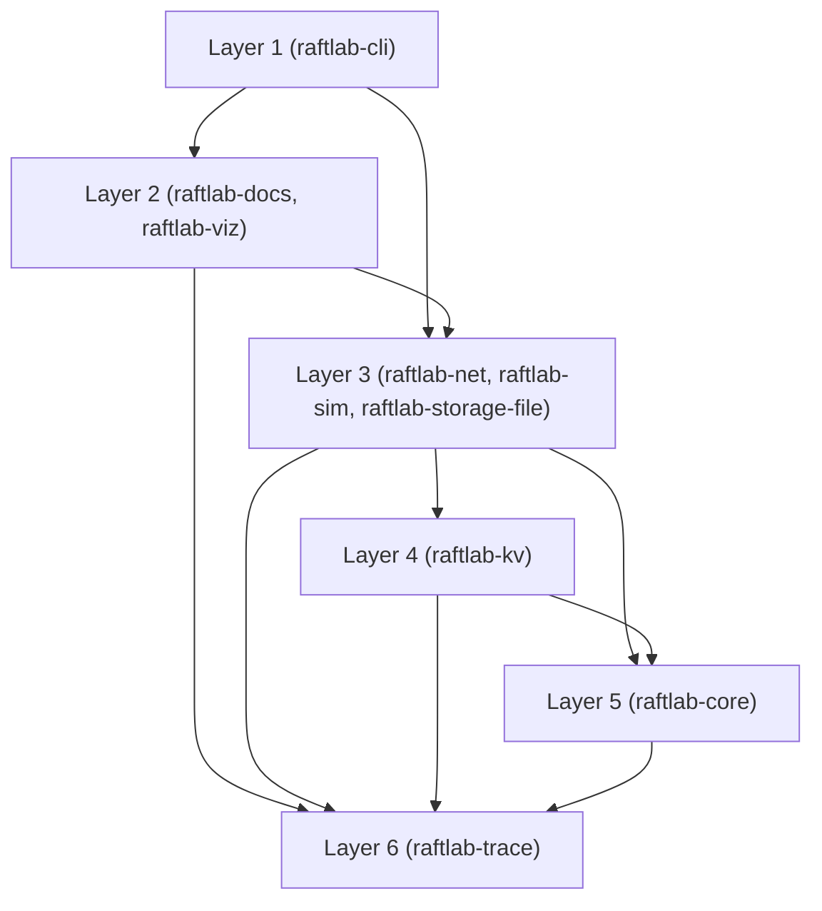

# raftlab

raftlab is an educational Raft consensus implementation in Kotlin. It ships a deterministic simulator, fuzzing with injected bugs, a linearizability checker, Mermaid and HTML trace visualizations, and a small TCP key-value cluster.

[](https://github.com/ok0/raftlab/actions/workflows/ci.yml) [](LICENSE) [](gradle/libs.versions.toml) [](https://adoptium.net/) [](https://github.com/ok0/raftlab/releases)

## Architecture

<!-- BEGIN GENERATED:architecture -->

<!-- END GENERATED:architecture -->

The diagrams above are generated from the module graph; see [docs/generated/architecture.md](docs/generated/architecture.md) and [docs/generated/modules.md](docs/generated/modules.md).

## Features

- Pure step-function core: `RaftNode` takes inputs and returns effects, with no I/O inside the consensus logic ([design notes](docs/design/core-and-determinism.md)).
- Leader election with pre-vote and leadership transfer ([leader election](docs/design/leader-election.md)).
- Log replication with the current-term commit rule ([log replication](docs/design/log-replication.md)).
- Snapshots and InstallSnapshot for lagging followers ([persistence and snapshots](docs/design/persistence-and-snapshots.md)).
- Single-server membership changes ([membership](docs/design/membership.md)).
- ReadIndex reads ([read index](docs/design/read-index.md)).
- Key-value state machine with sessions, duplicate suppression and compare-and-set (CAS) ([client semantics](docs/design/client-semantics.md)).
- Deterministic simulator with 10 named scenarios (`raftlab scenario list`).
- Invariant checks and a linearizability checker.
- Fuzzing over seed ranges, with 3 injectable mutations ([mutations](docs/design/mutations.md)).
- Mermaid sequence, state and log-table exports, and a self-contained HTML trace viewer.
- File storage (`FileStorage`) for durable state.
- TCP node runtime and a CLI key-value client (`raftlab node`, `raftlab kv`).
- Docker image and a compose example ([docker/README.md](docker/README.md)).

## Quick start

Run these from the repository root. Each block was executed after `./gradlew clean`; output is pasted as printed, and trimmed parts are marked with `...`.

```
git clone https://github.com/ok0/raftlab.git raftlab && cd raftlab
./gradlew build
./gradlew :raftlab-cli:installDist
alias raftlab="$PWD/raftlab-cli/build/install/raftlab/bin/raftlab"
raftlab scenario list
raftlab scenario run leader-crash --seed 7
raftlab export --scenario normal-election --seed 42 --format sequence --out build/election.md
raftlab fuzz --seeds 20 --mutation SKIP_LOG_UP_TO_DATE_CHECK
echo $?
```

`./gradlew build` ends with `BUILD SUCCESSFUL`; its full log is not pasted here. `raftlab scenario list` prints:

```
normal-election
leader-crash
partition-heal
minority-partition
client-write
fuzz-random
restart-all
lagging-follower-snapshot
membership-add-remove
leadership-transfer
```

`raftlab scenario run leader-crash --seed 7` prints:

```
scenario: leader-crash
seed: 7
mutations: none
expectation new leader at higher term: passed
expectation acknowledged writes survive: passed
expectation all nodes live: passed
expectation live nodes agree: passed
linearizability: LINEARIZABLE (84 states explored)
result: PASSED
```

`raftlab export --scenario normal-election --seed 42 --format sequence --out build/election.md` prints nothing and writes `build/election.md` (a Mermaid sequence diagram that starts with `sequenceDiagram`).

`raftlab fuzz --seeds 20 --mutation SKIP_LOG_UP_TO_DATE_CHECK` prints (seeds 6 to 15 trimmed):

```
fuzz 'fuzz-random' seeds 0..19, mutations: SKIP_LOG_UP_TO_DATE_CHECK
seed 0: INVARIANT: leader-completeness at t=448: leader n3 (term 2) does not hold committed entry at index 2 (term 1) (+11 more)
  repro: raftlab scenario run fuzz-random --seed 0 --mutation SKIP_LOG_UP_TO_DATE_CHECK
seed 5: INVARIANT: leader-completeness at t=1371: leader n3 (term 4) does not hold committed entry at index 11 (term 3) (+4 more)
  repro: raftlab scenario run fuzz-random --seed 5 --mutation SKIP_LOG_UP_TO_DATE_CHECK
...
seed 18: INVARIANT: leader-completeness at t=2109: leader n2 (term 8) does not hold committed entry at index 5 (term 6) (+1 more)
  repro: raftlab scenario run fuzz-random --seed 18 --mutation SKIP_LOG_UP_TO_DATE_CHECK
summary: 20 seeds run, 14 passed, 6 failed, first failing seed 0
```

`echo $?` prints `1`: the fuzz command exits 1 when any seed fails.

### Local 3-node cluster

After `./gradlew :raftlab-cli:installDist`, the automated smoke test starts three `raftlab node` processes, runs KV operations, kills and restarts a node, and checks that acknowledged writes survive:

```
scripts/cluster-smoke.sh
```

Observed output and exit code 0:

```
killing n1 (leader: n1)
killing n2
PASS: cluster smoke
```

Manual flow (ports 7001 to 7003; data goes under `build/cluster`):

```
CLUSTER=n1=127.0.0.1:7001,n2=127.0.0.1:7002,n3=127.0.0.1:7003
raftlab node --id n1 --cluster "$CLUSTER" --data-dir build/cluster/n1 &
raftlab node --id n2 --cluster "$CLUSTER" --data-dir build/cluster/n2 &
raftlab node --id n3 --cluster "$CLUSTER" --data-dir build/cluster/n3 &
raftlab kv --cluster "$CLUSTER" put greeting hello
raftlab kv --cluster "$CLUSTER" get greeting
kill %1 %2 %3
```

The last line stops the three nodes in a fresh shell where they are jobs 1 to 3; if `jobs` shows other numbers, pass those instead. Observed output of the two KV commands (node start-up lines are omitted):

```
OK
hello
```

### Docker

Build and start the three-node compose example with `docker compose up --build -d`. The steps and the image usage are in [docker/README.md](docker/README.md).

## Usage

| Command | Purpose | Key options |
| --- | --- | --- |
| `raftlab scenario list` | List the simulator scenario names. | none |
| `raftlab scenario run NAME` | Run one scenario for one seed and report PASSED or FAILED. | `--seed` (default 42), `--mutation` (repeatable), `--trace FILE` |
| `raftlab export` | Render a state or sequence Mermaid diagram, a log table, or an HTML trace viewer from a trace file or a scenario run. | `--trace`, `--scenario`, `--seed`, `--format`, `--from`, `--to`, `--nodes`, `--at`, `--out` |
| `raftlab docs` | Regenerate `docs/generated` and the README architecture region, or compare them with `--check`. | `--check`, `--out`, `--module-graph`, `--readme` |
| `raftlab fuzz` | Run the fuzz-random scenario over a seed range and print failing seeds with reproduction lines. | `--seeds` (default 1000), `--start` (default 0), `--mutation` (repeatable) |
| `raftlab node` | Run one Raft node over TCP with file storage until SIGINT or SIGTERM. | `--id`, `--cluster`, `--data-dir`, `--trace`, `--tick-millis` (default 50) |
| `raftlab kv` | Run one key-value operation against a cluster: `put`, `get`, `delete` or `cas`. | `--cluster`, `--timeout-millis` (default 10000) |

Exit codes: 0 for success, 1 for a failed check, 2 for a usage error.

Examples (each was executed; the first one writes `build/run.jsonl`):

```
raftlab scenario run leader-crash --seed 7 --trace build/run.jsonl
raftlab export --trace build/run.jsonl --format logtable
raftlab export --scenario partition-heal --format html --out build/partition-heal.html
raftlab kv --cluster "$CLUSTER" cas greeting hello world
raftlab kv --cluster "$CLUSTER" cas greeting hello again
```

The log table prints:

```
**t = 3618 ms**

Indexes 1-35 not shown.

| Node | Status | 36 | 37 | 38 | 39 | 40 | 41 | 42 | 43 | 44 | 45 | 46 | 47 | 48 | 49 | 50 | 51 | 52 | 53 | 54 | 55 |
| --- | --- | --- | --- | --- | --- | --- | --- | --- | --- | --- | --- | --- | --- | --- | --- | --- | --- | --- | --- | --- | --- |
| n1 | up | **3** | **3** | **3** | **3** | **3** | **3** | **3** | **3** | **3** | **3** | **3** | **3** | **3** | **3** | **3** | **3** | **3** | **3** | **3** | **3** |
| n2 | up | **3** | **3** | **3** | **3** | **3** | **3** | **3** | **3** | **3** | **3** | **3** | **3** | **3** | **3** | **3** | **3** | **3** | **3** | **3** | **3** |
| n3 | up | **3** | **3** | **3** | **3** | **3** | **3** | **3** | **3** | **3** | **3** | **3** | **3** | **3** | **3** | **3** | **3** | **3** | **3** | **3** | **3** |
| n4 | up | **3** | **3** | **3** | **3** | **3** | **3** | **3** | **3** | **3** | **3** | **3** | **3** | **3** | **3** | **3** | **3** | **3** | **3** | **3** | **3** |
| n5 | up | **3** | **3** | **3** | **3** | **3** | **3** | **3** | **3** | **3** | **3** | **3** | **3** | **3** | **3** | **3** | **3** | **3** | **3** | **3** | **3** |
```

The `partition-heal` HTML export prints nothing and writes a self-contained file (about 0.6 MB) that opens offline in a browser.

With `greeting` set to `hello`, the first CAS command prints `OK`. The second CAS command, which still expects `hello`, prints the following and exits 1:

```
CAS_FAILED world
error: kv cas failed: current value is world
```

A fuzz failure prints a reproduction line of this form, which runs the same seed alone:

```
repro: raftlab scenario run fuzz-random --seed N --mutation NAME
```

## Diagram gallery

Generated diagrams live in `docs/generated`; start from [docs/generated/index.md](docs/generated/index.md). Selected pages:

- [Leader election](docs/generated/election.md)
- [Log replication, including catch-up with InstallSnapshot](docs/generated/replication.md)
- [Roles during a leader crash](docs/generated/roles-leader-crash.md)
- [Partition heal log table](docs/generated/partition-heal-log.md)
- [Roles during election](docs/generated/roles-election.md)
- [Module dependencies](docs/generated/modules.md)
- [Architecture](docs/generated/architecture.md)

The HTML trace viewer is also generated on demand and works offline:

```
raftlab export --scenario leader-crash --format html --out build/leader-crash.html
```

## Project structure

| Module | Layer | Purpose | Depends on |
| --- | --- | --- | --- |
| `raftlab-cli` | 1 | The `raftlab` command-line interface | docs, sim, viz, net, storage-file |
| `raftlab-docs` | 2 | Generator of `docs/generated` and the README architecture region | sim, viz |
| `raftlab-viz` | 2 | Mermaid, log-table and HTML exporters, Mermaid lint | trace |
| `raftlab-net` | 3 | TCP transport, node runtime, KV client | kv, core, trace, storage-file |
| `raftlab-sim` | 3 | Deterministic simulator, scenarios, invariants, linearizability checker, fuzzing | core, trace, kv |
| `raftlab-storage-file` | 3 | Durable `FileStorage` | core |
| `raftlab-kv` | 4 | KV state machine, sessions, client protocol | core, trace |
| `raftlab-core` | 5 | Raft step function, messages, storage contract, mutations | trace |
| `raftlab-trace` | 6 | Trace event model and JSONL codec | none |

A module depends only on modules in a higher-numbered (lower) layer, with two same-layer exceptions: `raftlab-net` depends on `raftlab-storage-file`, and `raftlab-docs` depends on `raftlab-viz`. `./gradlew verifyModuleBoundaries` enforces this. [docs/generated/modules.md](docs/generated/modules.md) is authoritative.

Other top-level directories:

- `build-logic/`: Gradle convention plugins and the `checkRepoDocs` and `countLoc` tasks.
- `scripts/`: cluster smoke test, Mermaid validation, release and image checks.
- `docs/`: design notes, generated diagrams and release notes ([index](docs/README.md)).
- `docker/`: Docker image notes; the root `Dockerfile` and `docker-compose.yml` build the image and the compose example.
- `.github/`: CI and release workflows, issue and pull request templates.

## Development

Requirements: JDK 21 or newer (the toolchain is 21; CI also runs Gradle on JDK 25). Use the Gradle wrapper (`./gradlew`). Node 22 is needed only for the optional Mermaid validation.

| Command | Purpose |
| --- | --- |
| `./gradlew build` | Full check: tests, ktlint, module boundaries, docs checks, fuzz run and coverage gate |
| `./gradlew test` | Unit and integration tests |
| `./gradlew ktlintCheck` / `./gradlew ktlintFormat` | Check or format Kotlin style |
| `./gradlew generateDocs` / `./gradlew checkDocs` | Regenerate, or verify, `docs/generated` and the README region |
| `./gradlew checkRepoDocs` | Check required repository files and relative Markdown links |
| `./gradlew :raftlab-sim:fuzzTest -Praftlab.fuzz.seeds=200` | Fuzz run over 200 seeds (default 1000) |
| `./gradlew koverHtmlReport` / `./gradlew koverVerify` | Coverage report; `koverVerify` enforces at least 85 % line coverage of `raftlab-core` |
| `./gradlew dokkaGenerate` | API reference from KDoc |
| `./gradlew countLoc` | Source line counts per module |
| `(cd .github/mermaid && npm ci) && scripts/validate-mermaid.sh` | Optional Mermaid validation |

See [CONTRIBUTING.md](CONTRIBUTING.md) for the pull request workflow and commit message rules, and [docs/README.md](docs/README.md) for the design notes.

Acceptance evidence for every project acceptance criterion, and the checklist to run after the first push, are in [docs/acceptance.md](docs/acceptance.md).

## Status and limitations

- raftlab is an educational project and is **not production-ready**.
- No TLS, authentication or authorization: the TCP transport and the CLI are not secured.
- No performance claims or benchmarks are provided.
- Not published to Maven Central. Distribution is through GitHub Releases and the GHCR image; see [docs/release.md](docs/release.md) and [docker/README.md](docker/README.md).
- Known limitations:
  - `FileStorage` writes the snapshot data and the snapshot metadata as two files. A crash between those two writes can leave them out of step, and the next open then fails instead of recovering ([persistence and snapshots](docs/design/persistence-and-snapshots.md)). In the TCP runtime, a storage error stops the node.
  - The `COMMIT_PREVIOUS_TERM_ENTRIES` mutation is not caught by the fuzz scenario in seeds 0 to 99; a targeted unit test covers it ([mutations](docs/design/mutations.md)).
  - No CheckQuorum and no leader leases. Membership changes are single-server changes only ([membership](docs/design/membership.md)).
- To report a vulnerability, see [SECURITY.md](SECURITY.md).

## License

Licensed under the Apache License 2.0. See [LICENSE](LICENSE).
