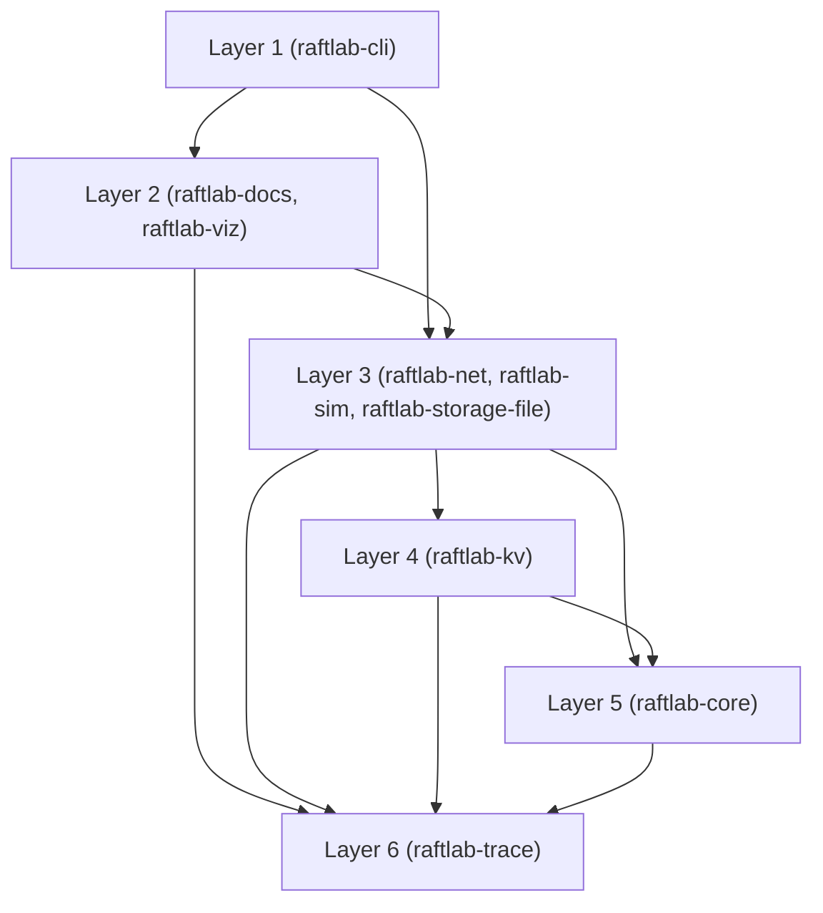
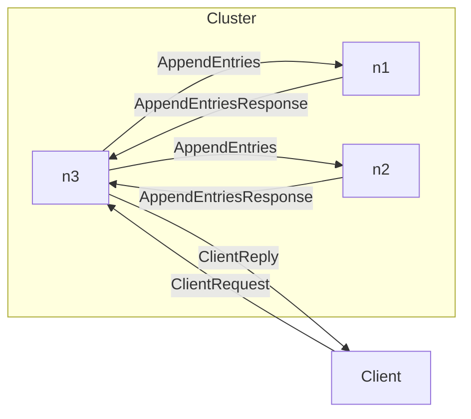

<!-- GENERATED by ./gradlew generateDocs. Do not edit. -->
# Architecture

System overview by module layer, and the message flow of the first client write in the 3-node client-write run (seed 42).

## System overview

## Client write message flow

The client request to the leader, the distinct messages (sender, receiver, kind) in first-seen order until the leader commits the first client command, and the reply.

