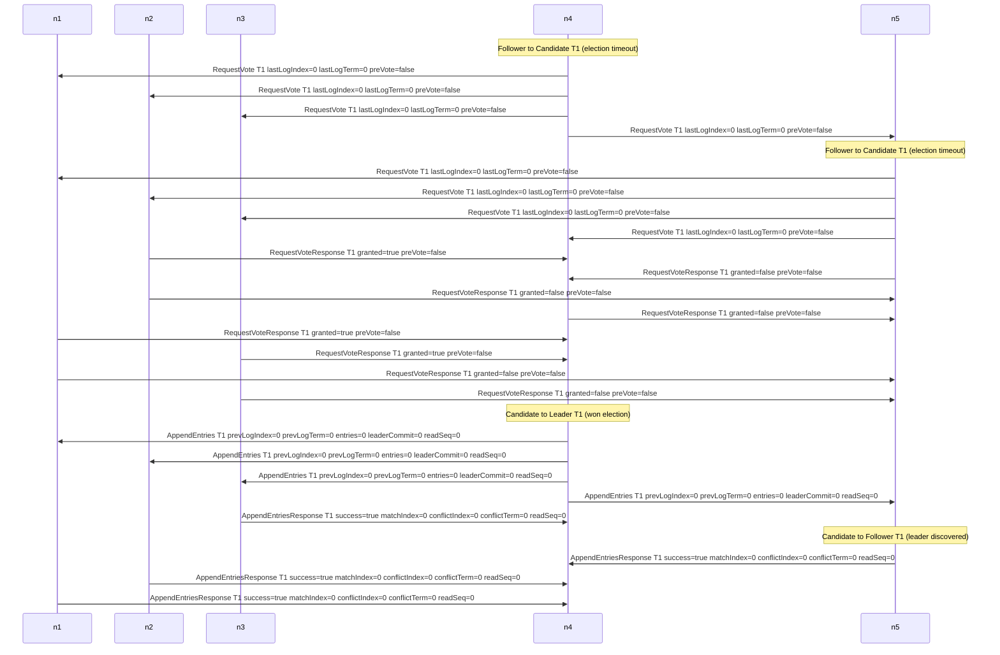

<!-- GENERATED by ./gradlew generateDocs. Do not edit. -->
# Leader election

Messages of the 5-node normal-election run (seed 42, default SimOptions) from 0 ms until the new leader has a response from every follower to its first AppendEntries round at 143 ms, at most 60 messages.

