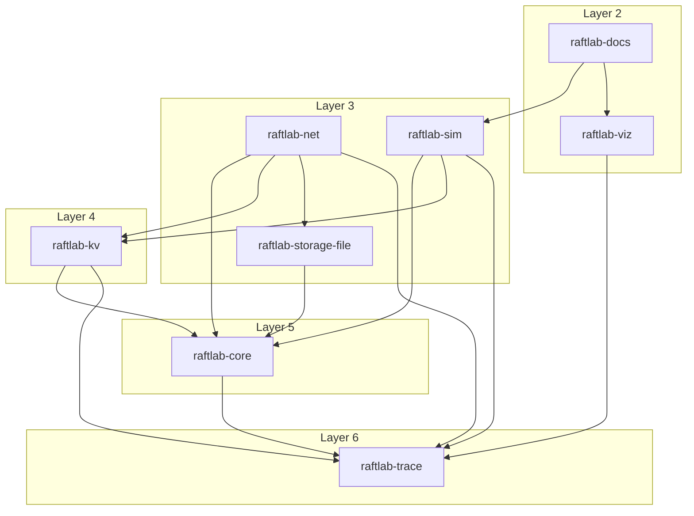

<!-- GENERATED by ./gradlew generateDocs. Do not edit. -->
# Module dependencies

Project dependencies (main configurations) between the Gradle modules, grouped by layer, read from build/raftlab/module-graph.json written by ./gradlew writeModuleGraph.

