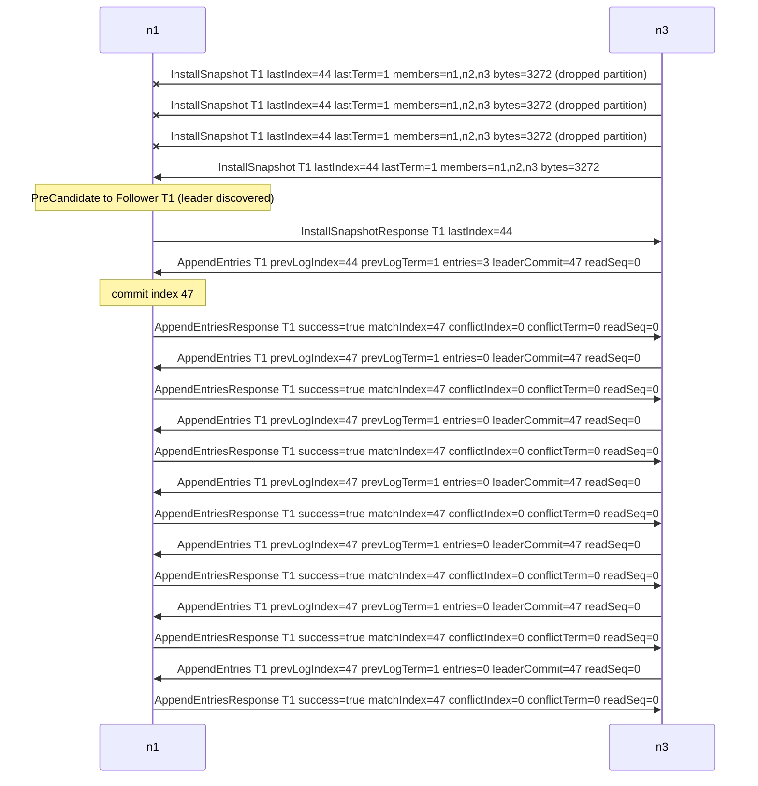

<!-- GENERATED by ./gradlew generateDocs. Do not edit. -->
# Log replication to a lagging follower

Messages between leader n3 and lagging follower n1 in the 3-node lagging-follower-snapshot run (seed 42) from 1920 to 2220 ms, at most 60 messages: the follower is behind and is brought up to date with InstallSnapshot and AppendEntries.

