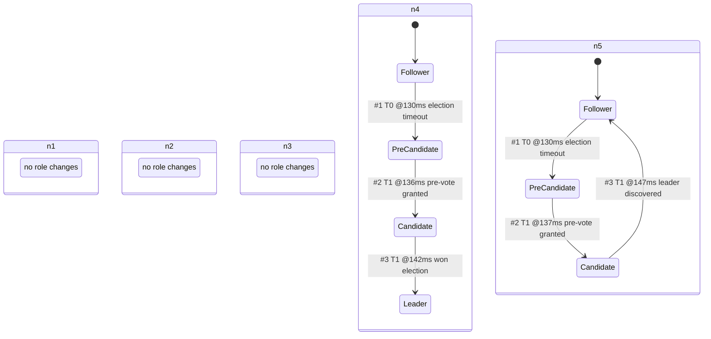

<!-- GENERATED by ./gradlew generateDocs. Do not edit. -->
# Node roles during leader election

Role changes of every node in the 5-node normal-election run (seed 42, default SimOptions), the same run as election.md.

