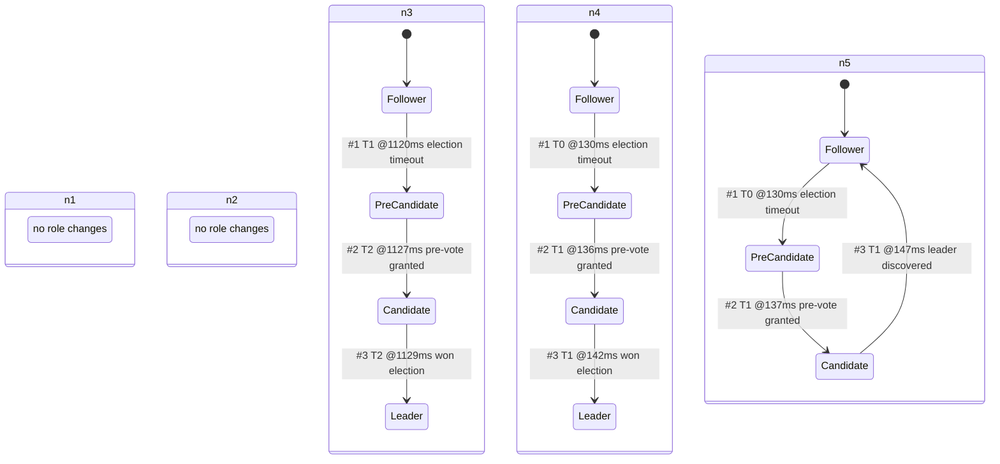

<!-- GENERATED by ./gradlew generateDocs. Do not edit. -->
# Node roles across a leader crash

Role changes of every node in the 5-node leader-crash run (seed 42): leader n4 crashes at 1000 ms and n3 becomes leader at 1129 ms, n4 restarts at 2000 ms.

